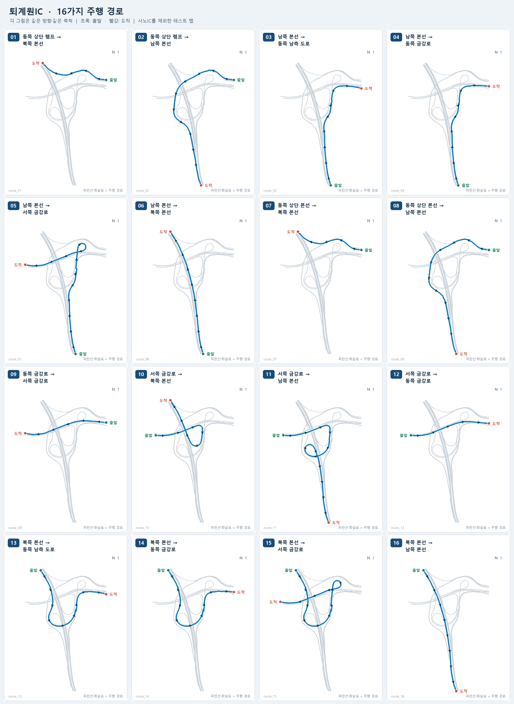

# Stage 3 고밀도(15,000 vph) 학습 실패율 및 원인 분석 리뷰

> 작성일: 2026-11-15  
> 대상 모델: `results/mcw_runs/stage3_high_v2/best_model.pt` (`@40960`, 6/16 완주) 및 `@102400` 평가 추이  
> 진단 원자료: `results/mcw_runs/stage3_high_v2/diag_failed_routes.json`, `eval_40960.json`, `eval_102400.json`

---

## 1. 퇴계원 IC 16개 경로 번호 지도 (`01` ~ `16`)

| 번호 | 경로 ID | 진입 → 진출 | `@40960` (best) | `@102400` | 비고 |
| :---: | :--- | :--- | :---: | :---: | :--- |
| **01** | `route_01` | 동쪽 상단 램프 → 북쪽 본선 | 완주 | 완주 | |
| **02** | `route_02` | 동쪽 상단 램프 → 남쪽 본선 | 타임아웃 | 타임아웃 | `169929488#0` 차로0 정지 |
| **03** | `route_03` | 남쪽 북향 본선 → 동쪽 남측 도로 | 타임아웃 | 타임아웃 | `52873356` 차로0 정지 |
| **04** | `route_04` | 남쪽 북향 본선 → 동쪽 금강로 | 타임아웃 | 타임아웃 | `52873356` 차로1→0 미변경 정지 |
| **05** | `route_05` | 남쪽 북향 본선 → 서쪽 금강로 | 타임아웃 | 타임아웃 | `52873356` 차로0 정지 |
| **06** | `route_06` | 남쪽 북향 본선 → 북쪽 본선 | **충돌** | 타임아웃 | `52873356_1` 후미 추돌 |
| **07** | `route_07` | 동쪽 상단 본선 → 북쪽 본선 | 완주 | **충돌** | |
| **08** | `route_08` | 동쪽 상단 본선 → 남쪽 본선 | 완주 | 타임아웃 | |
| **09** | `route_09` | 동쪽 금강로 → 서쪽 금강로 | 완주 | 완주 | |
| **10** | `route_10` | 서쪽 금강로 → 북쪽 본선 | **충돌** | **충돌** | `170059993_0` 후미 추돌 |
| **11** | `route_11` | 서쪽 금강로 → 남쪽 본선 | 타임아웃 | 타임아웃 | `544293888#0` 차로0→1 미변경 정지 |
| **12** | `route_12` | 서쪽 금강로 → 동쪽 금강로 | 완주 | 완주 | |
| **13** | `route_13` | 북쪽 남향 본선 → 동쪽 남측 도로 | 타임아웃 | 타임아웃 | `86198728` 차로0 정지 |
| **14** | `route_14` | 북쪽 남향 본선 → 동쪽 금강로 | 타임아웃 | 타임아웃 | `86198728` 차로0 정지 |
| **15** | `route_15` | 북쪽 남향 본선 → 서쪽 금강로 | 타임아웃 | 타임아웃 | `86198728` 차로1→0 미변경 정지 |
| **16** | `route_16` | 북쪽 남향 본선 → 남쪽 본선 | 완주 | 완주 | |

---

## 2. Stage 3 (`stage3_high_v2`) 평가 추이

| 평가 시점 | 완주 (Arrival) | 충돌 (Collision) | 타임아웃 (Timeout) | 비고 |
| :--- | :---: | :---: | :---: | :--- |
| 시작 (`stage3_high @51200`) | 5/16 (31.2%) | 7/16 (43.8%) | 4/16 (25.0%) | |
| `@20480` | 5/16 (31.2%) | 7/16 (43.8%) | 4/16 (25.0%) | |
| **`@40960` (`best_model.pt`)** | **6/16 (37.5%)** | **2/16 (12.5%)** | 8/16 (50.0%) | 충돌 대폭 감소, 타임아웃 증가 |
| `@61440` | 4/16 (25.0%) | 2/16 (12.5%) | 10/16 (62.5%) | |
| `@81920` | 4/16 (25.0%) | 2/16 (12.5%) | 10/16 (62.5%) | |
| `@102400` | 4/16 (25.0%) | 2/16 (12.5%) | 10/16 (62.5%) | |

---

## 3. 실패 원인 상세 분석 (`best_model.pt` 기준 10개 실패 경로 정밀 진단)

### A. 충돌 (Collision: `2/16 = 12.5%`) — 풀스피드 후미 추돌

| 경로 | 발생 스텝 | 충돌 위치 (Edge / Lane / 좌표) | 충돌 대상 및 상황 |
| :--- | :---: | :--- | :--- |
| **`06` (`route_06`)** 남쪽 본선 → 북쪽 본선 | 47 step (9.4초) | • Edge/Lane: `52873356_1` (남쪽 북향 본선 1차로) • 위치: `pos=261.11m`, XY `(1741.13, 751.11)` | • Ego 속도 **`27.78 m/s` (100 km/h)** • 앞차 `flow_route_06.76` 속도 `23.52 m/s`, 차간거리 `0.87m` • 감속 없이 최고 속도로 직진하다 그대로 후미 추돌 |
| **`10` (`route_10`)** 서쪽 금강로 → 북쪽 본선 | 101 step (20.2초) | • Edge/Lane: `170059993_0` (서쪽 진입 후 램프 합류부 0차로) • 위치: `pos=88.57m`, XY `(1638.31, 1439.18)` | • Ego 속도 **`27.78 m/s` (100 km/h)** • 앞차 `flow_route_11.6` 속도 `20.20 m/s`, 차간거리 `0.65m` • 합류 구간에서 앞차 속도 차이를 줄이지 못하고 후미 추돌 |

---

### B. 타임아웃 (Timeout: `8/16 = 50.0%` → `@102400` 기준 `10/16 = 62.5%`)

진단 결과 **실패한 8개 타임아웃 경로 모두에서 차선 변경 시도 횟수가 `lc_attempts = 0`**이었고, 종료 시점 **`speed = 0.0 m/s`, `leader_gap = null`(앞차 없음)** 상태였습니다. 크게 두 가지 패턴으로 나뉩니다.

#### 패턴 B-1. 이미 목표 차로에 있고 앞차도 없는데 정지 상태 고착 (4건: `03, 05, 13, 14`)

| 경로 | 정체 위치 (Edge / Lane / 좌표) | 목표 차로 (`prep_targets`) | 남은 거리 (`prep_dist`) | 상태 |
| :--- | :--- | :---: | :---: | :--- |
| **`03` (`route_03`)** | `52873356` / `lane 0` / `(1744.25, 751.94)` | `[0]` (이미 일치) | 190.3m | 앞차 없음(`null`), 속도 `0.0 m/s` |
| **`05` (`route_05`)** | `52873356` / `lane 0` / `(1772.64, 621.94)` | `[0]` (이미 일치) | 323.5m | 앞차 없음(`null`), 속도 `0.0 m/s` |
| **`13` (`route_13`)** | `86198728` / `lane 0` / `(1483.09, 1637.85)` | `[0]` (이미 일치) | 129.6m | 앞차 없음(`null`), 속도 `0.0 m/s` |
| **`14` (`route_14`)** | `86198728` / `lane 0` / `(1475.75, 1650.15)` | `[0]` (이미 일치) | 143.9m | 앞차 없음(`null`), 속도 `0.0 m/s` |

- **원인**: 15,000 vph 고밀도 환경에서 충돌(`-15.0`)과 TTC 페널티를 피하려다, **한 번 속도를 `0 m/s`까지 줄인 뒤 다시 가속하지 않고 정지 상태로 버티는 보수적 정책**에 빠짐 (`@102400` 기준 `route_04, 05`의 평균 속도가 각각 `0.006 m/s`, `0.0003 m/s`).

#### 패턴 B-2. 분기 전 차선 변경을 전혀 시도하지 않아 막다른 차로 끝에서 정지 (4건: `02, 04, 11, 15`)

| 경로 | 정체 위치 (Edge / Lane / 좌표) | 목표 차로 (`prep_targets`) | 남은 거리 (`prep_dist`) | 상태 |
| :--- | :--- | :---: | :---: | :--- |
| **`02` (`route_02`)** | `169929488#0` / `lane 0` / `(1750.08, 1613.54)` | `[1, 2]` (좌측 이동 필요) | 0.0m | 차선 변경 `0회`, 속도 `0.0 m/s` |
| **`04` (`route_04`)** | `52873356` / `lane 1` / `(1720.52, 940.75)` | `[0]` (우측 이동 필요) | 0.0m | 차선 변경 `0회`, 속도 `0.0 m/s` |
| **`11` (`route_11`)** | `544293888#0` / `lane 0` / `(1759.92, 1349.25)` | `[1]` (좌측 이동 필요) | 0.0m | 차선 변경 `0회`, 속도 `0.0 m/s` |
| **`15` (`route_15`)** | `86198728` / `lane 1` / `(1546.46, 1525.03)` | `[0]` (우측 이동 필요) | 0.0m | 차선 변경 `0회`, 속도 `0.0 m/s` |

- **원인**: 결정론적 평가(`deterministic=True`)에서 `lane_keep_bias=1.0` + `lc_penalty=0.02` + 고밀도 주변 차량 때문에 차선 변경 행동이 한 번도 선택되지 못해(`lc_attempts=0`), 분기점 끝(`prep_dist=0.0m`)에 도달해 멈춰 섬.

---

## 4. 진단 요약 및 개선 포인트

1. **보상 불균형 (정지 고착)**: 충돌 패널티(`-15.0`)·TTC 감점 대비 전진 속도 보상(`speed_weight=0.1`)이 약해, 저속/정지(`0 m/s`)가 안전한 선택으로 학습됨 → 저속/정지 페널티(예: `speed < 2 m/s`일 때 앞차가 없으면 감점) 또는 전진 보상을 강화할 필요가 있음.
2. **차선 변경 위축 (`lc_attempts = 0`)**: 고밀도 환경에서 `lane_keep_bias=1.0`이 너무 커서 결정론적 평가 시 차선 변경을 전혀 안 함 → `lane_keep_bias` 완화 및 차선 변경 성공/준비 보상 비중 점검 필요.
3. **일부 직진 구간 과속 추돌 (`06`, `10`)**: 정지하는 경로와 반대로, 출발 직후 `27.78 m/s`를 유지하는 구간에서는 앞차와의 속도 차이에 따른 감속이 부족함.
